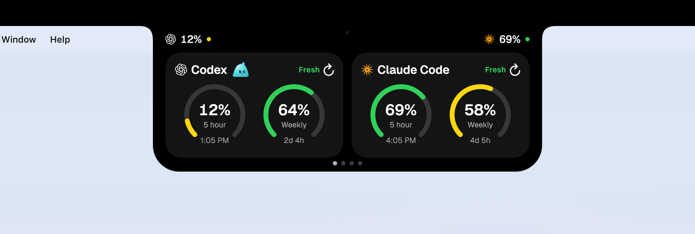

# Maxim Marchenkov — product designer

[Русская версия](README.md)

I take my own ideas all the way to working software, building them with AI coding
agents (mostly Claude Code). Code is how I test and ship a design, not a second job title.

[Telegram](https://t.me/maxim_fakel) · Rostov-on-Don

---

## Selected work

### [CapaTheNotch](https://github.com/maximfakel/capa-the-notch) · macOS app · open source

AI coding agents' usage limits in the MacBook notch, plus a teleprompter under the camera, on-device dictation, a calendar, a translator and a shelf for files.

**Why:** my limits kept running out mid-task without my noticing, the notch was dead screen space — and I wanted to see if I could ship a native app with an AI agent.

**My part:** I designed, specified and shipped it; it was implemented with Claude Code, and I review the builds and make small code edits myself.

[Site](https://capathenotch.tech/) · [decision records](https://github.com/maximfakel/capa-the-notch/tree/main/docs/adr)

## How I work

1. **Frame it.** The problem, what is in and out of scope, and the product's words
   ([example glossary](https://github.com/maximfakel/capa-the-notch/blob/main/CONTEXT.md)).
2. **Design it.** Mockups in Paper or Figma, agreed before any code is written.
3. **Spec it.** An AI agent interviews me; I confirm the spec; it becomes small tickets
   ([spec](https://github.com/maximfakel/capa-the-notch/blob/main/.scratch/capacity-notch/spec.md) ·
   [tickets](https://github.com/maximfakel/capa-the-notch/tree/main/.scratch/capacity-notch/issues)).
4. **Build it with agents.** Claude Code implements; I review the builds, make small code edits myself,
   decide, and keep every trade-off in a decision record ([ADRs](https://github.com/maximfakel/capa-the-notch/tree/main/docs/adr)).
5. **Ship it.** Release notes, a smoke test, a landing page, distribution.

Things I care about in every build: accessibility (keyboard, VoiceOver, Reduce Motion, states that don't rely on colour),
motion that costs nothing at rest, sound used sparingly, and plain wording.
