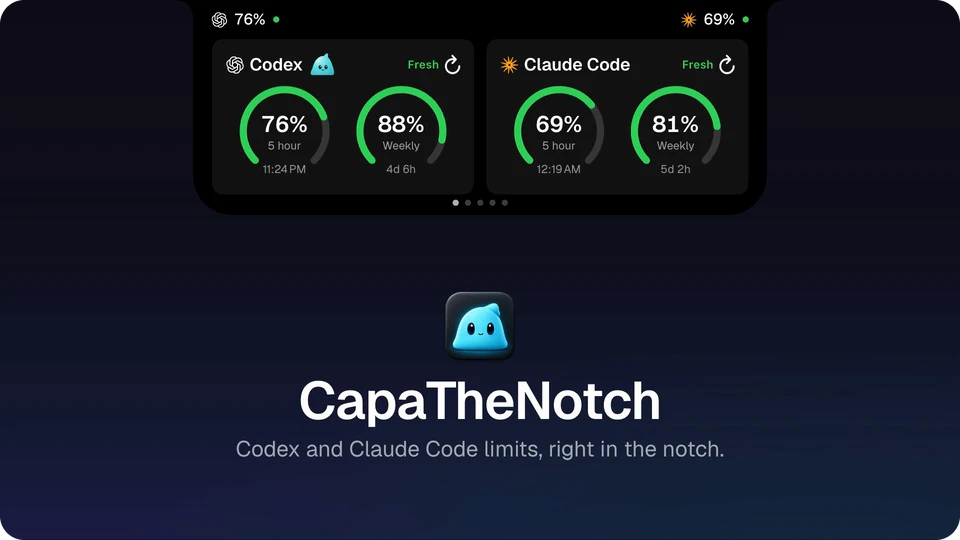

# Maxim Marchenkov — product designer

[Русская версия](README.md)

I take my own ideas all the way to working software, building them with AI coding
agents (mostly Claude Code). Code is how I test and ship a design, not a second job title.

[Portfolio](https://maximfakel.ru/en) · [Telegram](https://t.me/maxim_fakel) · Rostov-on-Don

---

## Selected work

### [CapaTheNotch](https://github.com/maximfakel/capa-the-notch) · macOS app · open source

Shows how much of your Claude Code, Codex and OpenCode limits is left, right in the MacBook notch. It also holds music, a file shelf, a teleprompter under the camera, offline Russian dictation, a calendar and a translator. 20 releases in 17 days.

**Why:** my limits kept running out mid-work without my noticing. The notch is always in sight, yet it sat empty. And I wanted to see whether I could take a native app all the way to release together with an AI agent.

**My part:** I came up with the app and designed it: the features, how they work, the key screens, Kapa and the decisions — each one written up as an ADR. Claude Code wrote the code; I checked every build by hand, fixed small things and shipped the releases.

[Site](https://capathenotch.tech/) · [decision records](https://github.com/maximfakel/capa-the-notch/tree/main/docs/adr)

## How I work

1. **Frame it.** The problem, what is in and out of scope, and the product's words
   ([example glossary](https://github.com/maximfakel/capa-the-notch/blob/main/CONTEXT.md)).
2. **Spec it.** An AI agent interviews me about the product; together we turn the answers into a spec and split it into small tickets
   ([spec](https://github.com/maximfakel/capa-the-notch/blob/main/.scratch/capacity-notch/spec.md) ·
   [tickets](https://github.com/maximfakel/capa-the-notch/tree/main/.scratch/capacity-notch/issues)).
3. **Design it.** I draw the key screens in Paper or Figma. The agent makes the rest from my design, and I finish them by hand.
4. **Build it with the agent.** Claude Code writes the code. I check every build by hand — the agent can't feel how an interface behaves under the pointer. Every trade-off goes into an [ADR](https://github.com/maximfakel/capa-the-notch/tree/main/docs/adr).
5. **Ship it.** Release notes, a smoke test, a landing page, distribution.

Things I care about in every build: the app keeps and sends nothing it doesn't need, motion costs almost nothing at rest, sound plays only at a few moments, and the wording is plain.
