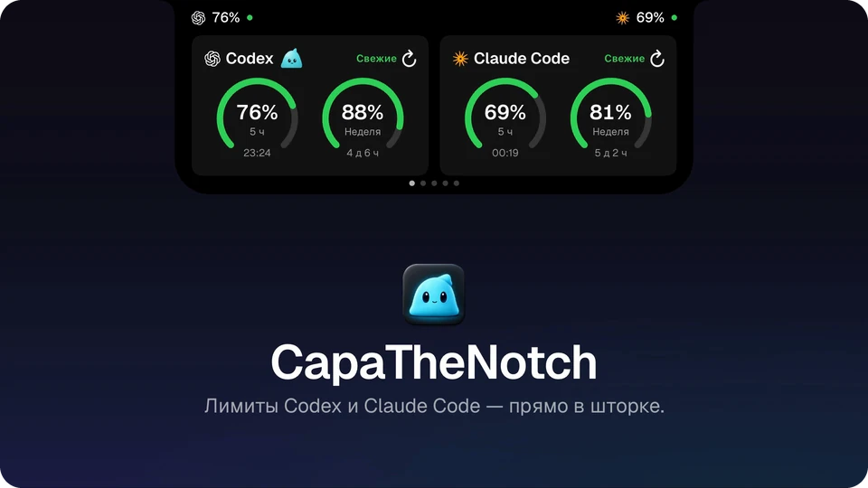

# Максим Марченков — продуктовый дизайнер

[English version](README-en.md)

Довожу свои идеи до работающего продукта и собираю его с AI-агентами — чаще всего с Claude Code. Код для меня — способ проверить и выпустить дизайн, а не вторая профессия.

[Telegram](https://t.me/maxim_fakel) · Ростов-на-Дону

---

## Работы

### [CapaTheNotch](https://github.com/maximfakel/capa-the-notch) · macOS-приложение · open source

Показывает, сколько осталось лимитов Claude Code, Codex и OpenCode, — прямо в «шторке» MacBook. Ещё в ней музыка, полка для файлов, суфлёр под камерой, офлайн-диктовка на русском, календарь и переводчик. 20 релизов за 17 дней.

**Зачем:** лимиты заканчивались посреди работы, а я этого не замечал. «Шторка» — место, которое видно всегда, но оно пустовало. И хотелось проверить, смогу ли я довести нативное приложение до релиза вместе с AI-агентом.

**Моя роль:** придумал и спроектировал приложение: фичи, как они работают, ключевые экраны, Капу и решения — каждое записано в ADR. Код писал Claude Code, а я проверял каждую сборку руками, правил мелочи и выпускал релизы.

[Сайт](https://capathenotch.tech/) · [записи решений](https://github.com/maximfakel/capa-the-notch/tree/main/docs/adr)

## Как я работаю

1. **Формулирую задачу.** Проблема, что входит в объём и что нет, словарь продукта
   ([пример глоссария](https://github.com/maximfakel/capa-the-notch/blob/main/CONTEXT.md)).
2. **Пишу спецификацию.** AI-агент расспрашивает меня о продукте, из ответов мы собираем спецификацию и делим её на небольшие тикеты
   ([спецификация](https://github.com/maximfakel/capa-the-notch/blob/main/.scratch/capacity-notch/spec.md) ·
   [тикеты](https://github.com/maximfakel/capa-the-notch/tree/main/.scratch/capacity-notch/issues)).
3. **Проектирую.** Ключевые экраны рисую в Paper или Figma. Остальные агент делает по моему дизайну, а я довожу их руками.
4. **Собираю с агентом.** Код пишет Claude Code. Каждую сборку я проверяю руками — агент не чувствует, как интерфейс ведёт себя под курсором. Каждый компромисс записываю в [ADR](https://github.com/maximfakel/capa-the-notch/tree/main/docs/adr).
5. **Выпускаю.** Заметки к релизу, smoke-тест, лендинг, распространение.

Что для меня важно в каждой сборке: приложение не хранит и не отправляет лишнего, анимация почти ничего не стоит в покое, звук — только в нескольких моментах, а слова в интерфейсе простые.
